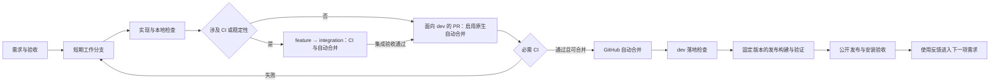

# 开发、集成与发布流程

本仓固定采用 **GitHub Flow，以 `dev` 为主线**：从主线创建短期工作分支，通过 PR 和持续集成（CI）交付小批改动。需求按优先级持续推进，完成一项就交付一项。规则、CI、门控、发布链和稳定性改动先通过短期 `integration/` 的真实 PR 验证，验收后再交付到 `dev`。

仓库默认分支为 `dev`，负责开发、测试版发布和部署验收；`main` 保存正式版的固定源码。正式候选完成测试版及下游验收后，按[正式版晋升入口](release-iteration.md#推进正式版分支)将 `main` 非强制快进到同一提交，再发布正式版并验收安装。首次 `main` 采用已公开的 `v0.1.2` 源码；分支存在本身不证明后续版本已经发布或部署。

这份宿主规范供维护者和开发 AI 使用，负责串起需求、实现、CI、合并、发布和反馈。产品能力以 [SPEC](../SPEC.md) 为准；机器检查、合并和发布参数分别由现有登记负责，本文不复制执行配方。

## 方法与职责

| 层次 | 固定做法 | 解决的问题 |
| --- | --- | --- |
| 工作安排 | 按优先级拉取小任务，限制同时在做的工作，及时处理失败反馈 | 让需求能持续交付；不要求固定 Sprint 或新增会议 |
| 软件工程 | 需求和验收 → 审计已有能力 → 必要重构 → 实现与验证 | 每项改动有实际使用方、明确范围和可观察结果 |
| 分支协作 | GitHub Flow；主线为 `dev`，工作分支短期存在 | 用 PR 集成改动，避免长期分支持续分叉 |
| 持续集成 | 本地与 CI 使用登记的同一检查入口，按 DELTA 选择检查 | 把已知正确性要求落实到可重复运行的检查 |
| 自动合并 | PR 提前启用 GitHub 原生自动合并，由远端保护和必需 CI 决定准入 | CI 满足要求后直接合并，无需等待 AI 再执行合并 |
| 持续交付 | 核对落地提交，再构建、验证、打包和发布固定源码 | 区分“已合并”“已发布”和“使用方已采用” |

敏捷是组织和反馈原则，GitHub Flow 是分支协作方法，CI／持续交付是自动化方式。本仓按上表组合采用。`integration/` 是现有规则要求的临时验证分支，不建立额外的长期发布主线。

## 一项工作的完整路径

图表示完整交付目标；各段当前自动化程度见下文。

1. **明确需求。** 写清实际使用方、当前问题、范围、限制和成功／失败条件，对照 SPEC。简单任务可写在 PR 正文中；跨 PR 的工作保留明确依赖与交付范围。
2. **隔离候选。** 通过[工作树入口](worktree.md)从创建时最新 `dev` 创建短期分支。普通工作走 `feature/` → `dev`。涉及规则、CI、门控、发布链或稳定性时，另建新的 `integration/` 基线，先走 `feature/` → `integration/` 的 PR；必需 CI 通过并实际合入、核对集成结果后，才创建 `integration/` → `dev` 的 PR。两段 PR 都提前启用原生自动合并，并各验自己的固定合并树。integration 的修复继续通过 feature PR；仅创建或推送 integration 分支不算集成验收，因为主 CI 由面向它的 PR 触发。
3. **实现并验证。** 先复用已有能力，在真正负责的位置修改；同步登记当前使用方和依赖。关键逻辑验证成功、失败和边界行为；本地执行[共用检查入口](../.chrono-harness/instructions/host-context.md#本地ci-检查)。
4. **提交 PR 并启用自动合并。** 保存并推送候选，在正文写清问题、结果、验证范围和剩余限制。就绪 PR 创建或复用后立即通过[登记的合并入口](../.chrono-harness/instructions/host-context.md#自动交付授权)启用原生自动合并；草稿保留开发状态，转为就绪后再启用。仓库允许自动合并，并不代表每个 PR 已经启用。
5. **由 CI 决定准入。** `chrono / collection` 核对选中操作的真实结果；缺失、失败、取消或意外跳过不能算通过。GitHub 根据必需检查、冲突和现有保护执行合并。AI 读取失败原件并修复，推送后由新候选重新验收；成功后无额外人工或 AI 放行步骤。
6. **核对实际落地。** 调用方等待原生完成通知或现有阻塞等待通道，读取真实合并状态、落地 SHA 和 `dev` push 检查。核验是交付结果确认，不是合并前的第二道批准。并行 PR 的检查树与落地树可能不同，处理方式归[合并方案](merging.md)。
7. **发布并验收使用。** `dev` 的落地 CI 成功后，自动为该完整源码 SHA 发起[测试版发布](release-ci.md#持续交付与恢复)。全部登记平台和验证成功后，组合产物、公开固定版本，并在 Linux／macOS 安装验收。正式版先将受验源码晋升到 `main`，再通过同一工作流显式指定匹配源码计划的版本；integration 演练使用 `channel=build`。发布失败保留原件，修复后产生明确的新候选；不能把上传 Actions artifact 当成公开发布。
8. **收尾并反馈。** 等待全部自有任务结束，核对本项实际交付范围，再通过生命周期入口完成和回收可重建产物。未发布的工作只能报告已合并；未验收的使用方不能报告已经采用。

## CI 承担什么

已知要求应在产生结果的负责位置验证，并接入 FILEMAP、执行计划和现有汇总检查。CI 的目标是尽早发现会影响用户的失败。缺少检查时补当前要求对应的行为验证；修复漏检时保留回归用例。不能用增加手工批准替代缺失的检查。

本仓当前采用 scoped CI。绿色表示这个固定候选通过了当前登记并实际执行的检查；完整输入、全部 SPEC 和跨环境确定性仍有[已知缺口](spec-coverage.md)。这不改变“必需 CI 通过即可自动合并”的准入规则。合并后发现的新交互由落地检查和反馈修复，不能声称任何方法能保证零缺陷。

## 并行改动与真实冲突

独立 PR 继续异步验收和自动合并，保持 strict 关闭。已知会互相影响的改动先在 integration 验证组合；不要把目标分支单纯前移当作全量重跑理由。发现冲突或明确依赖变化时，保全两边工作，解决实际合同与实现的冲突，再补验受影响范围。

共同合同放在实际负责和消费它的位置。本仓首先采用 [units.json](../.chrono-harness/ci/units.json) 的 `job_gating.startup`：生成器用其 schema、目录、工件名和下载 action 连接 detector 的共享启动生产者与各 CI 使用方。这四个共同字段保持在同一物理行，使用方列表仍独立维护。两个候选分别改变这些字段的不同值时，第一项合入后，第二项应产生 Git 文本冲突，使未经验证的组合不能直接自动合并。现有严格解码、生成／verify 和启动合同检查继续核实际内容，不增加无使用方的版本号、锁或全局序号。

文本冲突只覆盖共同内容发生不同修改的情况。同值修改、独立行、未改变合同的内部实现交互，都可能干净合并；不能把这个表示当作语义兼容性证明。已知交互即使没有文本冲突，也须先在 integration 验组合。新增共同合同或检查须点名当前生产者、使用方和验收；不把全仓压成一行来阻塞独立工作。

原生验收用临时 integration PR 核对：同基线的两个候选分别 CI 绿，第一项合入后第二项实际冲突；解决组合并重新通过 CI 后才能继续；另一个独立候选仍可合并。生产配置、生成行为和 GitHub 结果分别取证，不能用本地构造冲突代替远端准入验收。

## 发布策略与当前自动化

测试版的四个下游采用、问题反馈、稳定判据和正式版交付按[发布迭代流程](release-iteration.md)执行。先完成测试版，再按固定候选的实际验收决定是否发布正式版；流程和 skill 随真实执行改进。

发布工作流订阅 `dev` 的 `chrono / collection` 完成事件，仅原始 push 检查成功才自动构建测试版。测试版版本包含原 CI run／attempt 和完整源码 SHA；正式版必须来自 `main` 当前指向的同一固定源码，并显式指定与源码计划相同的版本。版本唯一绑定源码，不能覆盖已有公开版本或把移动的分支名当发布身份。当前发布计划由 [plan.json](../.chrono-harness/release/plan.json)负责，原 CI 身份、发布和恢复合同归[发布说明](release-ci.md#持续交付与恢复)。

下面列出工作流实现的行为。一次交付是否成功，以对应源码的真实落地检查、原生发布报告、公开资产和两平台安装结果为准；登记或生成成功不能代替这些结果。

| 环节 | 当前能力 | 完成的验收依据 |
| --- | --- | --- |
| 需求、实现和失败修复 | 开发 AI 在任务授权内执行 | 需求对应的实际行为、提交和检查原件 |
| PR 的 CI | 已接通；按固定合并候选和登记依赖选测 | 当前运行的 `chrono / collection` 及其原报告 |
| 原生自动合并 | 仓库已允许；每个就绪 PR 由调用方启用 | 远端 `autoMergeRequest` 或已经合并的实际状态 |
| 合并后的 CI | 已接通 `dev` push 检查 | 落地 SHA 对应运行的完整 before／after 结果 |
| 发布构建和验证 | 成功的 dev push CI 自动触发；integration 手动指定完整源码并使用 build 通道 | 固定源码、全部平台及原始验证／collector 结果 |
| 自动创建公开 Release、上传发行资产 | 发布作业验证原 CI，续传同身份 draft，核资产后公开并复核；只有该作业取得写权限 | 真实版本、标签源码、公开资产及原发布报告 |
| 安装验收 | 发布后由 Linux／macOS 作业安装；build 通道消费本次组合包，公开通道从固定版本 HTTPS 地址下载 | 安装器实际回执、完整工具成员、安装字节和执行权限；其他使用方按各自宿主验收 |

发布复用当前构建、打包、安装和保留所有者，核对源码身份、版本分配、失败恢复及公开资产。正式通道按[晋升合同](release-ci.md#正式版复用最终测试版)消费明确选定的最终测试版原件，保留原验证并重新验收正式安装。只使用已有权限；不能仅凭触发成功就声称已公开发布或安装通过。

## 负责位置和成本

| 当前需要 | 负责来源与输入 | 实际使用方和输出用途 | 验收与替代选择 |
| --- | --- | --- | --- |
| 固定开发方式 | 本文；输入为用户目标、SPEC 和现有入口 | 维护者／开发 AI 按同一路径交付 | PR、合并和发布状态可分别核对；复用现有 GitHub Flow 能力 |
| 让 AI 读到采用选择 | 宿主 host-context 链接本文 | 进入本仓工作的 AI 读取当前宿主流程 | 正式 generate；不复制产品默认规则 |
| 登记新增文档 | FILEMAP 的逐文件记录 | 现有文件核验器解释 DELTA | canonical check；不增加文档专属测试或新执行器 |
| 按检查结果自动合并 | GitHub 原生自动合并、现有规则集和 CI | GitHub 服务消费必需检查并更新目标分支 | 核对实际合并及落地 CI；无需另建合并机器人 |
| 交付固定版本 | 现有发布源、配方和分发工具 | 公开包与安装宿主消费经过验证的资产 | 原生平台与真实安装分别验收；继续复用当前生产入口 |

流程规范与共同合同表示由宿主采用；当前四个 startup 字段只调整物理排版，值和产品判定逻辑不变。验证使用正式生成／verify 入口、按 DELTA 选择的 canonical check，以及上述临时 integration 验收。持续发布另登记发布作业和两个安装作业，其权限、下载、输出和保留归发布说明；不新增常驻服务或合并机器人。开发、验证和持续发布的全生命周期总成本仍未测，不能用配置数量推算节省。
